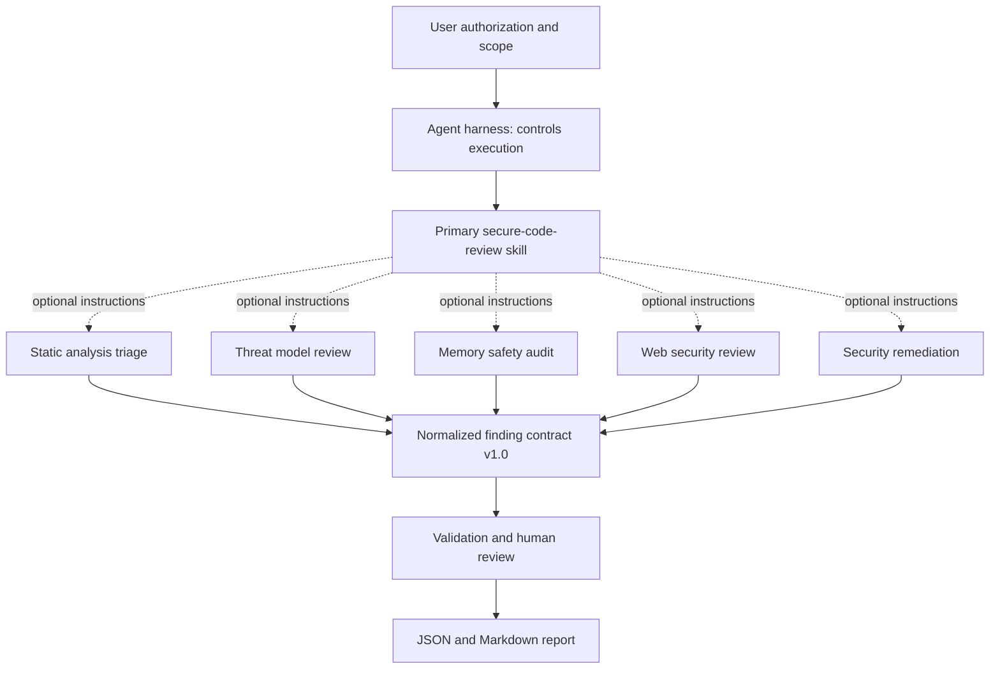

# Architecture

The model proposes conclusions and actions. The harness, user permissions, and external tools control execution. The skill description triggers activation; `SKILL.md` gives scoped instructions and optional references load on demand. There is no built-in cross-skill invocation protocol. The Python package provides deterministic SARIF parsing, correlation, inventory, reporting, evaluation scoring and structural checks. It is **not** a standalone SAST scanner.

**Data boundary:** target source and analyzer output are untrusted inputs. **Execution boundary:** source review defaults to read-only. **Reporting boundary:** machine assertions about vulnerabilities require source-level evidence and human validation. **Sharing boundary:** do not export secrets or private code without permission.
