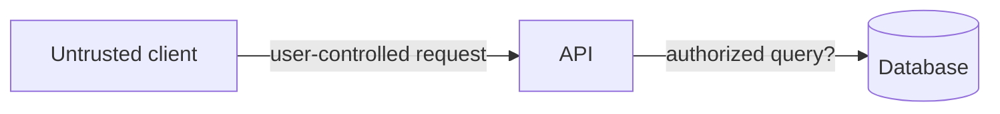

# Architecture review worksheet

Record: assets; principals; service boundaries; data stores; trust crossings; authentication mechanism; authorization decision point; secret/data flows; explicit security invariant; assumptions; and review priority.

Example (synthetic): `anonymous client → API gateway |external/internal boundary| → request handler → tenant-aware DB query`. Verify if the gateway authenticates, whether the handler authorizes per-record access, and whether downstream components independently restrict tenant data. This is a hypothesis, not proof of a flaw.

Mermaid notation (optional):

Review teams must validate these arrows against architecture evidence.
